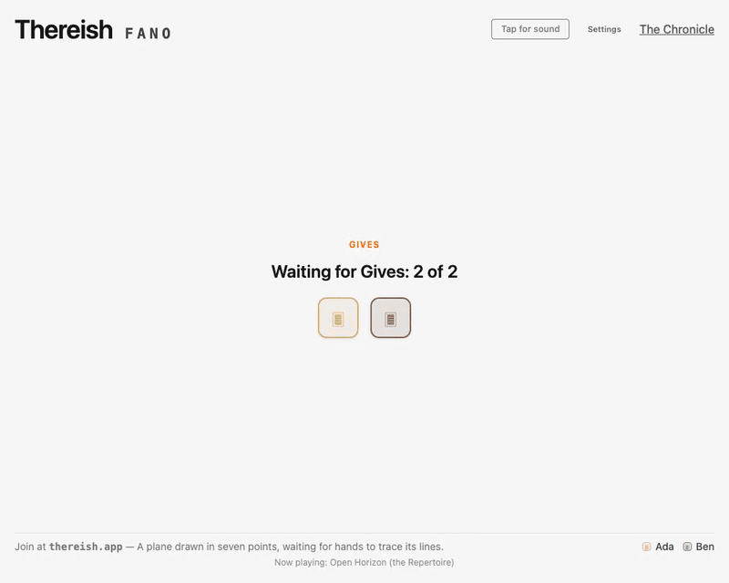

# Thereish

**Thereish is a realtime couch word game for two to six players**, built with
Elixir, Phoenix LiveView and Postgres. Everyone uses a phone to write the word
or phrase that bridges two far-apart meanings; a language model grades how
close the table came and writes the reveal's quip. A laptop can show the reveal
for everyone. No accounts, nothing to install.

<a href="https://thereish.app/game"></a>

What it is, for someone who has not played: **https://thereish.app/game**.
How and why it was built: [The machine grades. It never rules.](https://stephens.page/blog/the-machine-grades-it-never-rules/)

## Engineering highlights

- **Pure game rules, realtime rooms.** `lib/thereish/game.ex` owns the rules as
  a reducer with no timers, sockets or model calls. Room processes coordinate
  play; Phoenix LiveView renders the phones and shared Stage.
- **One interface for model work.** The Steward covers writing, grading,
  recaps and media generation, with configured providers for live play and a
  fake adapter for tests.
- **Repeatable verdicts with human control.** A cache keys grades by model,
  prompt version and normalized inputs. A joint player overrule changes the
  precedent; the Chronicle records what the players saw.
- **Measured model comparisons.** The current Author comparison alternates
  Flash and Astra within each Room, hides arm labels during play and records
  outcomes for a qualitative readout. Model-call metadata tracks latency and
  reported cost.

## Why I built it

I want to make a game which plays with meaning. Maybe it could even use an LLM
somehow. I want it more than anything else to be fun.

That note became Thereish: a game for two phones and a laptop, expanding to
six players when friends come round. Success is measured one way: My wife
likes it.

## How a Page goes

1. Someone opens a Room at `/new` and reads its **Code** aloud — a four-letter
   word the Scribe picks. Everyone else types the word and a name. No accounts.
2. Every Seat gives a **Give**: a setting, in a phrase. "Viking beaches." "The
   world St. Thérèse grew up in." A Give stays private until the first reveal.
3. The **Author** writes two **Bookends** at the table, in seconds — a word or
   phrase drawn from one Give, another from a second, chosen to stand far apart.
4. Everyone writes a **Bridge**: the word or phrase whose meaning spans both.
   Anything goes except a Bookend, or a Bridge this Page has already seen.
5. After a fixed **Beat**, the reveal: every Bridge, one number, its band on the
   **Ladder** — miss, adjacent, close, almost, meld, deep meld — and the
   **Assayer**'s quip about what was actually written. The reasoning is
   recorded, not read aloud.
6. A **Meld** ends the Page. A miss carries the two Bridges that landed furthest
   apart forward as the next **Attempt**'s Bookends, so a Page converges rather
   than repeats; after five Attempts it closes unmelded. "One more?" asks for
   fresh Gives.

Everything played goes into the Room's **Chronicle**: an append-only,
player-readable record of every Page, every Verdict, every joint overrule
(which becomes precedent), and the **Recap** the Scribe writes after everyone
has gone to bed. The Assayer grades; it never rules. Same inputs, same grade,
forever.

Any device can make itself the **Stage**: the reveal is performed on the laptop
for the whole table while the phones go quiet. **Foley** scores each Page with
an instrumental written from its Gives, speaks the quip, and plays the stings.

`CONTEXT.md` defines every capitalised word above.

## The machine's roles

The game talks to models through one seam, the **Steward** (ADR-0009). The
machine holds no player seat (ADR-0001): it takes only the jobs nobody at the
table could do better. Each role is a few lines of `config/config.exs`.

| Role | Job | Today |
|---|---|---|
| Author | writes the Bookends at the table | Gemini 3.8 Flash, A/B-tested per Page against GPT-6 Astra |
| Assayer | grades an Attempt's Bridges and writes the quip | Gemini 3.8 Flash at low effort, hedged, every Verdict cached as precedent |
| Scribe | names Rooms, titles Tracks, writes Recaps | Gemini 3.8 Flash for the fast jobs; Claude Fable 5.1 for Recaps, behind a Vale prose gate |
| Foley | music, effects, voice | Mureka for the Tracks, ElevenLabs for the forged stings, Hume Octave for the voice |

No model's word is final. A schema validator has the last say on every answer,
Elixir stemming keeps a Bridge from echoing a Bookend's root, and Vale reads the
Scribe's prose before the couple do (design law 14).

## Reading the design

- `docs/design-brief.md` — the design and how it got here: the target player,
  the settled decisions, the fourteen design laws, three playtests
- `CONTEXT.md` — the glossary: Room, Code, Seat, Page, Give, Bookends, Bridge,
  Attempt, Verdict, Meld, Chronicle, and the words each one avoids
- `docs/adr/` — the architecture decisions, their trade-offs and what each
  one replaced
- `docs/research/` — the reading behind the laws: LLM referees in word games,
  why group word games fail at two, model selection for a 2.5-second beat,
  name clearance
- GitHub issues — the tracker: specs are parent issues and tickets are
  sub-issues (`docs/agents/issue-tracker.md`); historical features remain in
  `.scratch/`

## The code

The Game keeps the rules in pure modules; Rooms coordinate their effects.

- `lib/thereish/game.ex` — the rules as a pure reducer: build state, apply an
  event, project what one Seat may see. No timers, no sockets, no models.
- `lib/thereish/rooms/` — a Room is a process; join by name, reconnect by
  snapshot
- `lib/thereish/ladder.ex` — the bands, as configuration the couch calibrates
- `lib/thereish/steward/` — the seam and its adapters (Gemini, Anthropic,
  OpenAI, Mureka, ElevenLabs, Hume), plus `Fake`, which every test grades against
- `lib/thereish/chronicle/` — the record's Ecto schemas; the log is the version
  history
- `lib/thereish/experiments.ex` — the model-comparison harness: alternating
  Author arms within each Room, blinded labels, outcomes written to the
  Chronicle and a qualitative readout
- `lib/thereish/scribe.ex`, `foley/`, `notice.ex`, `umami.ex` — after-play
  writing, sound, the operator's email, page views
- `lib/thereish_web/live/` — the door (`/`), `/new`, the Room (`/r/CODE`), its
  Stage (`/stage`), its Chronicle (`/chronicle`, or `/chronicle.md` for a
  human or an agent), and the operator's `/spend`

## Running it

Elixir, Erlang and Vale come from `mise` (`mise.toml` pins them); Postgres from
docker-compose:

```sh
mise install
docker compose up -d
mix setup
mix phx.server
```

Then http://localhost:4000. With no keys the app boots and Rooms open, but the
Author writes nothing and the Assayer grades nothing; `GEMINI_API_KEY` alone
makes it playable. Keys go in the shell, or in `.env.local` for the release
image:

| Key | What it turns on |
|---|---|
| `GEMINI_API_KEY` | the Assayer, the Author, Room naming, Foley's ear |
| `ANTHROPIC_API_KEY` | the Scribe's Recaps |
| `OPENAI_API_KEY` | the Author's Astra arm |
| `MUREKA_API_KEY` | a Track for every Page |
| `HUME_API_KEY`, `HUME_SECRET_KEY` | the Assayer's voice |
| `ELEVENLABS_API_KEY` | the alternative voice, and the forge's effects |

```sh
mix test          # the whole suite, against Steward.Fake — it never spends a cent
mix precommit     # compile with warnings as errors, format, test
```

## Deploying

Every push to `master` deploys to **https://thereish.app** through GitHub
Actions (`.github/workflows/deploy.yml`). `bin/deploy` is the manual route from
a clean, pushed `master`, and `bin/keys-to-server` carries the keys over. Spend
is visible at `/spend` and at the foot of each Room's Chronicle. See
`docs/deploy.md`.

## License

MIT; see `LICENSE`. The ENABLE word list in `priv/wordlists/` is public domain,
and the vendored agent skills are MIT; see `NOTICE`.
